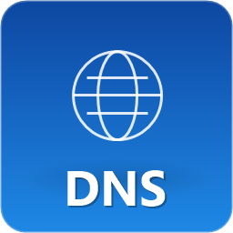
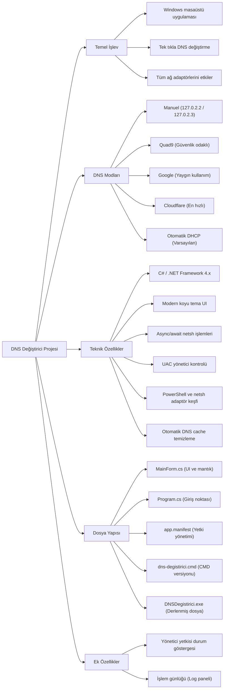

# DNS Değiştirici — Modern Windows DNS Manager

Tek tıkla DNS değiştiren, tüm aktif adaptörleri yöneten ve cache temizleyen modern Windows uygulaması. Manuel, Quad9, Google, Cloudflare ve DHCP arasında anında geçiş.

---

## 🎥 Tanıtım Videosu

<div align="center">

  <video width="800" controls preload="metadata" poster="icon256.png" playsinline style="max-width:100%; border-radius:12px; box-shadow:0 8px 24px rgba(0,0,0,0.4); background:#000; outline:none;">
    <source src="Dns Değiştirici İnceleme.mp4" type="video/mp4">
    <source src="./Dns%20De%C4%9Fi%C5%9Ftirici%20%C4%B0nceleme.mp4" type="video/mp4">
    Tarayıcınız video etiketini desteklemiyor. Videoyu <a href="Dns Değiştirici İnceleme.mp4">buradan indirip izleyebilirsiniz</a>.
  </video>

  <br/>
  <sub>▶️ Oynatmak için play tuşuna basın — GitHub'da doğrudan oynatılmazsa <a href="Dns Değiştirici İnceleme.mp4">videoyu açmak için tıklayın</a></sub>

  <!-- GitHub README <video> etiketini sanitize ettiği için fallback: önizleme görseli tıklayınca videoya gider -->
  <p>
    <a href="Dns Değiştirici İnceleme.mp4">
      
      <br/>
      <strong>📥 Videoyu İzle / İndir (MP4)</strong>
    </a>
  </p>

</div>

---

## 🗺️ Proje Haritası



---

## 🛠️ Tech Stack & Dependencies

- **Language & UI:** [C#](https://learn.microsoft.com/en-us/dotnet/csharp/) + [Windows Forms](https://learn.microsoft.com/en-us/dotnet/desktop/winforms/) (C# 5 uyumlu)
- **Runtime:** [.NET Framework 4.x](https://dotnet.microsoft.com/) — Windows ile hazır gelir, ek kurulum yok
- **System APIs:** `netsh`, `ipconfig /flushdns`, `NetworkInterface.GetAllNetworkInterfaces()`
- **Adapter Discovery:** [PowerShell](https://learn.microsoft.com/en-us/powershell/) `Get-NetAdapter` (fallback: `netsh interface show interface`)
- **Build Tool:** `csc.exe` (Framework 64-bit) + `app.manifest` (`requireAdministrator`) + `app.ico` (6 boyut: 16–256)

---

## ✨ Features

- **Canlı Adaptör Listesi** — Tüm `Up` adaptörleri (Ethernet, Radmin VPN dahil) ve mevcut DNS'i gösterir; yeşil = özel DNS, gri = otomatik
- **5 DNS Modu** — Tüm aktif adaptörlere aynı anda uygular:
  - `Manuel` — `127.0.2.2` / `127.0.2.3`
  - `Quad9` — `9.9.9.10` / `149.112.112.10` (güvenli, gizlilik odaklı)
  - `Google` — `8.8.8.8` / `8.8.4.4`
  - `Cloudflare` — `1.1.1.1` / `1.0.0.1` (en hızlı)
  - `Otomatik (DHCP)` — DNS'i otomatik al
- **Tek Tık Cache Temizleme** — `ipconfig /flushdns`
- **Akıllı Yetki Yönetimi** — Üstte durum pili: `✓ Yönetici aktif` (yeşil) / `✕ Yönetici yok` (kırmızı) + tek tıkla **Yönetici olarak yeniden başlat** teklifi; `app.manifest` ile UAC
- **Modern Koyu Tema** — 800×700, gradient header, yuvarlatılmış kartlar, hover efektleri, `Consolas` log paneli
- **Donmayan Arayüz** — Tüm `netsh` işlemleri `async/await` + `Task.Run` ile arka planda

---

## 🚀 Installation & Quick Start

### 1. Prerequisites

Windows 10/11 yeterlidir. Ek bir şey kurmaya gerek yok (.NET Framework ve PowerShell sistemde hazır).

Yönetici yetkisi **sadece** DNS değiştirmek için gerekir; cache temizleme yetkisiz de çalışır.

### 2. Get the App

Masaüstünde hazır:

```
C:\Users\alim\Desktop\DNSDegistirici.exe      # Ana uygulama (ikonlu, 62 KB)
C:\Users\alim\Desktop\dns-degistirici.cmd    # CMD versiyonu (alternatif)
```

Veya kaynaktan derle (aşağıya bak).

### 3. Run

Çift tık → **UAC**’ı onayla → `✓ Yönetici yetkisi aktif` gör → istediğin DNS butonuna bas:

- `Yenile` → adaptörleri yenile
- `MANUEL` / `Quad9` / `Google` / `Cloudflare` / `OTOMATIK` → seçili DNS tüm adaptörlere uygulanır + cache otomatik temizlenir
- `DNS Cache Temizle` → sadece cache temizler

CMD versiyonu:

```cmd
# Sağ tık → Yönetici olarak çalıştır
dns-degistirici.cmd
# 1 Manuel  2 Quad9  3 Google  4 Cloudflare  5 Otomatik  6 Flush  7 Çıkış
```

---

## 📝 Example Output

**GUI Log Paneli:**
```
[15:47:47] Adaptörler yenilendi - 2 adaptör bulundu.
[15:48:10] Cloudflare DNS ayarlanıyor (1.1.1.1 / 1.0.0.1)...
[15:48:10] [OK] Ethernet -> 1.1.1.1, 1.0.0.1
[15:48:10] [OK] Radmin VPN -> 1.1.1.1, 1.0.0.1
[15:48:10] Windows IP Yapılandırması
[15:48:10] DNS Çözümleyici Önbelleği başarıyla temizlendi.
[15:48:10] Tamamlandı: 2 başarılı, 0 hatalı
```

**CMD:**
```
Quad9 DNS'e Geçiriliyor... 9.9.9.10 / 149.112.112.10
--- Adaptor: "Ethernet" ---
[OK] "Ethernet" Quad9 DNS'e güncellendi.
--- Adaptor: "Radmin VPN" ---
[OK] "Radmin VPN" Quad9 DNS'e güncellendi.
Toplam 2 adaptör Quad9 DNS'e güncellendi.
Windows IP Yapılandırması
DNS Çözümleyici Önbelleği başarıyla temizlendi.
```

---

## 🔧 Configuration

Yeni bir DNS sağlayıcısı eklemek için `MainForm.cs` ve `dns-degistirici.cmd`’yi düzenle:

**`MainForm.cs` — yeni sağlayıcı ekle:**

```csharp
private readonly string myPrimary = "9.9.9.9";
private readonly string mySecondary = "149.112.112.112";

// InitUI() içinde buton oluştur:
btnMyDNS = CreateDnsButton("MyDNS", "9.9.9.9",
  Color.FromArgb(0,120,212), Color.FromArgb(0,90,158),
  x, y, bw, bh, "Etiket");
btnMyDNS.Click += async (s,e) => await SetDnsAsync(myPrimary, mySecondary, "MyDNS");
```

**`dns-degistirici.cmd` — menüye ekle:**

```cmd
echo  8 - MyDNS (9.9.9.9 / 149.112.112.112)
if "%secim%"=="8" goto mydns

:mydns
call :applyDns "9.9.9.9" "149.112.112.112" "MyDNS"
goto menu
```

Icon’u değiştirmek için `make_icon.ps1`’i çalıştır → `app.ico` yeniden oluşur.

---

## 📂 Project Structure

```
DNSDegistiriciApp/
├── Program.cs        # Entry point
├── MainForm.cs       # UI + DNS mantığı (521 satır, C# 5)
├── app.manifest      # requireAdministrator
├── app.ico           # 29 KB, 6 boyut (16,32,48,64,128,256)
├── icon256.png       # 256px önizleme
├── make_icon.ps1     # Icon üretim scripti
└── README.md
Masaüstü/
├── DNSDegistirici.exe    # Derlenmiş uygulama
└── dns-degistirici.cmd   # CMD versiyonu
```

**Derleme (SDK gerekmez):**

```powershell
& "C:\Windows\Microsoft.NET\Framework64\v4.0.30319\csc.exe" `
  /target:winexe /win32icon:"app.ico" /win32manifest:"app.manifest" `
  /out:"DNSDegistirici.exe" "Program.cs" "MainForm.cs" `
  /reference:"C:\Windows\Microsoft.NET\Framework64\v4.0.30319\System.Windows.Forms.dll" `
  /reference:"C:\Windows\Microsoft.NET\Framework64\v4.0.30319\System.Drawing.dll" `
  /reference:System.dll
```

---

## 📄 License

MIT — dilediğin gibi kullan, değiştir, dağıt.

